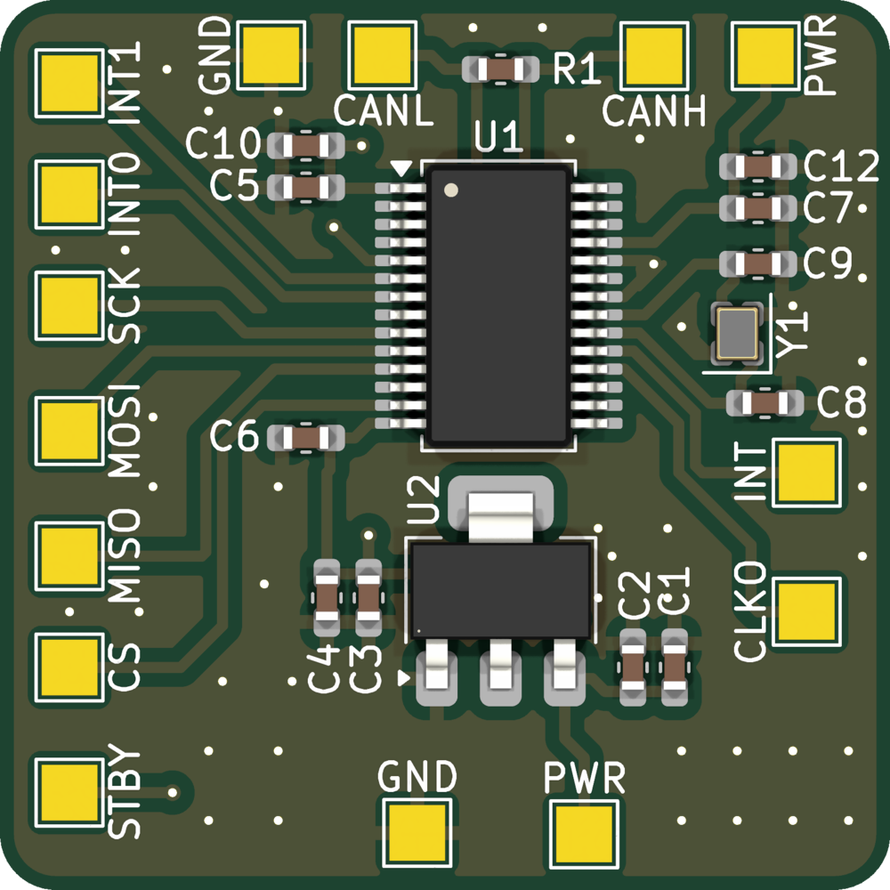
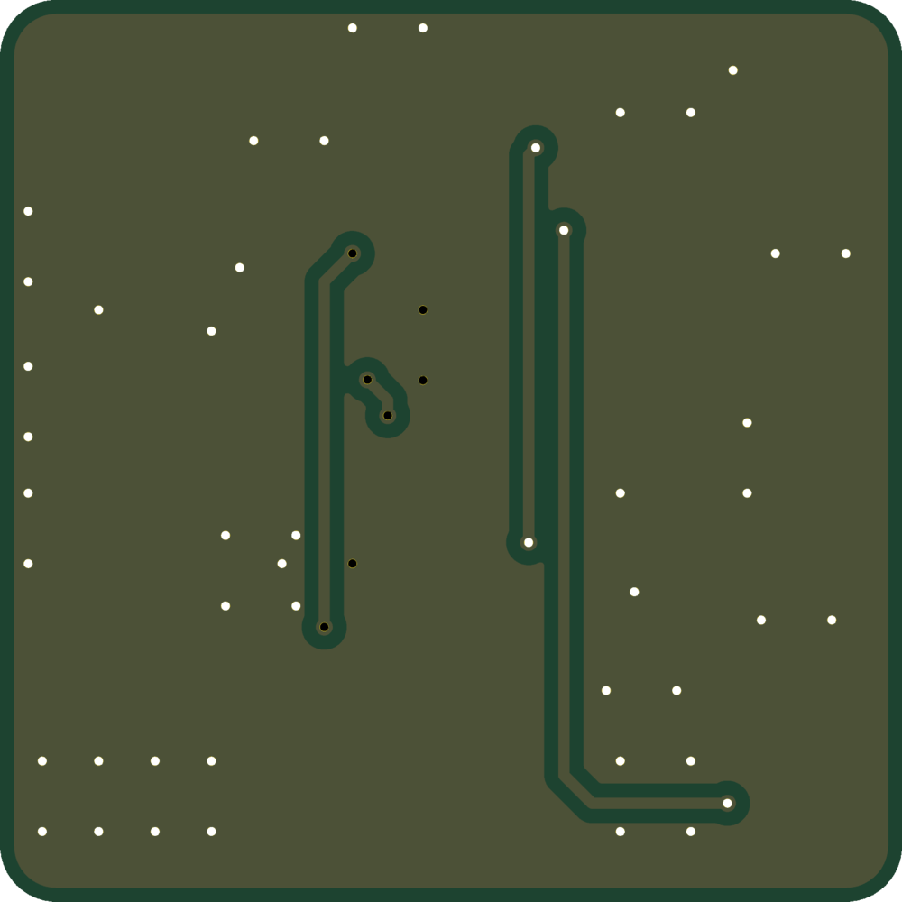

# MCP251863Breakout

A CAN FD breakout: an MCP251863 (CAN FD controller with integrated transceiver) on SPI, with an
onboard 3.3 V regulator and 120 Ω termination. All connections are solder pads.

 

Designed in KiCad 10. See [SimpleCANBreakout](https://github.com/jlpoltrack/SimpleCANBreakout) for a classic-CAN
transceiver-only board.

## Features

- MCP251863 CAN FD controller + transceiver (SSOP-28), SPI interface, STBY on its own pad
- 4-pin crystal (Y1, 2016) for the controller clock
- AMS1117 3.3 V LDO for VDD/VIO; transceiver VCC from +5V
- 120 Ω termination resistor, always fitted
- Parts on the top side only

## Connections

All pads are 2.0 × 2.0 mm, labelled with their signal name.

| Pad  | Signal                              |
|------|-------------------------------------|
| CS   | SPI chip select (active low)        |
| SCK  | SPI clock                           |
| MOSI | SPI data in (SDI)                   |
| MISO | SPI data out (SDO)                  |
| INT  | interrupt (active low)              |
| INT0 | GPIO0 / TX interrupt (active low)   |
| INT1 | GPIO1 / RX interrupt (active low)   |
| CLKO | clock output                        |
| STBY | transceiver standby (high = standby) |
| CANH | CAN bus high                        |
| CANL | CAN bus low                         |
| PWR  | +5V (two pads: bottom edge, and beside CANH) |
| GND  | GND (two pads: bottom edge, and beside CANL) |

SPI, interrupt and STBY pins are 3.3 V logic (VIO = 3.3 V). STBY has no pull-down on the board: drive it low (or tie it
to GND) for normal operation; the transceiver goes to standby when it is high. INT0 (GPIO0) can drive it as XSTBY.

## Termination

R1 (120 Ω) is permanently connected across CANH/CANL, so the board is meant to sit at an end of the bus. Leave R1
unpopulated if the board is used mid-bus.

## Bill of materials

| Ref                  | Value           | Package    | LCSC    |
|----------------------|-----------------|------------|---------|
| U1                   | MCP251863T-H/SS | SSOP-28    |         |
| U2                   | AMS1117-3.3     | SOT-223    | C6186   |
| Y1                   | crystal         | 2016 4-pin |         |
| C1, C4, C10, C12     | 10 µF 25 V X5R  | 0603       | C96446  |
| C2, C3, C5, C6, C7   | 100 nF 50 V X7R | 0603       | C14663  |
| C8, C9               | 10 pF 50 V C0G  | 0603       | C1634   |
| R1                   | 120 Ω 1 %       | 0603       | C22787  |

All LCSC numbers above are JLC basic parts. U1 and Y1 have none set.

## Files

- `MCP251863Breakout.kicad_sch` / `.kicad_pcb` / `.kicad_pro` — KiCad project
- `MCP251863Breakout.pdf` — schematic
- `production/` — fabrication outputs generated with the [Fabrication Toolkit](https://github.com/bennymeg/Fabrication-Toolkit) plugin: Gerbers and drill files (`MCP251863Breakout.zip`), BOM, and pick-and-place positions, ready for JLCPCB

## License

[MIT](LICENSE)
